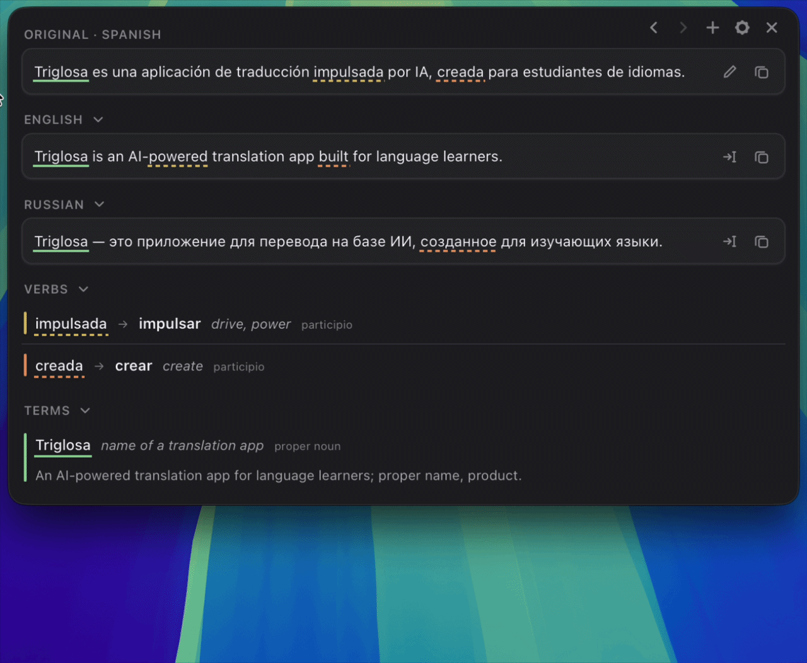
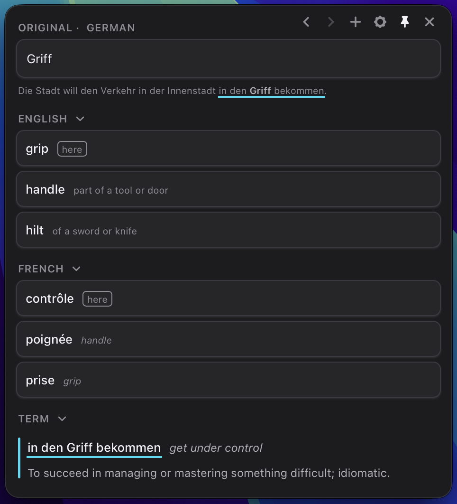

# Triglosa

Triglosa is an AI-powered translation app made for language learners. It is free and open source.

Select some text in any language anywhere on your PC or Mac and press a shortcut, or copy or share it on your iPhone, and Triglosa shows it next to one or two translations in the languages of your choice, with the words worth learning at your level explained.

## Download

- **Windows:** [Get Triglosa from the Microsoft Store](https://apps.microsoft.com/store/detail/9MZFPHCD9TSM) (recommended), or download the [installer](https://github.com/mdd335/triglosa/releases/latest/download/Triglosa-Windows-Setup.exe) directly.
- **Mac:** Triglosa for [Macs with an M1 chip or newer](https://github.com/mdd335/triglosa/releases/latest/download/Triglosa-Apple-Silicon.dmg) or for [older Macs with an Intel chip](https://github.com/mdd335/triglosa/releases/latest/download/Triglosa-Intel.dmg). Which one you have is shown under  → About This Mac.
- **iPhone:** [Get Triglosa from the App Store](https://apps.apple.com/app/id6829218889).

How to install, step by step: [see below](#installing).



**What makes Triglosa different**

- **No need to pick languages every time.** Triglosa recognizes the language on its own and translates into the language(s) relevant for you, according to your settings.
- **Translation on hover (Windows and Mac).** Point at any word to see what it became in your language.
- **Every word is clickable** for translations, explanations, base forms, synonyms and example sentences.
- **AI-enhanced flashcards from any word**, in Triglosa or straight from a word you select or share in any other app, sent to Anki with one click.
- **Made for your level.** It highlights the words that are hard at your level, from A1 to C2.
- **Your choice of AI model:** any cloud service, or on Windows and Mac a local model so your texts never leave your computer.

**Supported languages**

Triglosa translates text from any language the AI model knows. Your own language and the languages you are learning can be:

- English, Spanish, French, German, Portuguese, Russian and Italian
- Arabic, for now only as a language you learn

You can also learn and translate into 42 further languages, among them Polish, Turkish, Greek, Hindi, Chinese, Japanese and Korean. Triglosa is not optimised for these: mistakes are more frequent, and the more capable the AI model, the better the result.

Feel free to [open an issue](https://github.com/mdd335/triglosa/issues) if your language is missing.

## Installing

### Windows

**You need Windows 11 on a PC with an Intel or AMD processor.** Windows 10 probably works, but has not been tested.

1. Open [Triglosa in the Microsoft Store](https://apps.microsoft.com/store/detail/9MZFPHCD9TSM) and click **Install**. The Store also brings every update.
2. Open Triglosa from the Start menu.

If you prefer the [installer](https://github.com/mdd335/triglosa/releases/latest/download/Triglosa-Windows-Setup.exe): open it after downloading. Windows warns the first time, because the installer is not signed. Click **More info**, then **Run anyway**.

### Mac

**You need macOS 26 or newer.**

1. Download Triglosa for [Macs with an M1 chip or newer](https://github.com/mdd335/triglosa/releases/latest/download/Triglosa-Apple-Silicon.dmg) or for [older Macs with an Intel chip](https://github.com/mdd335/triglosa/releases/latest/download/Triglosa-Intel.dmg).
2. Open it and drag Triglosa into Applications.
3. Open Triglosa from Applications.

### iPhone

**You need iOS 18 or newer**, and iOS 26 for Apple's translation on the iPhone.

1. Install [Triglosa from the App Store](https://apps.apple.com/app/id6829218889).
2. Copy a text in any app, open Triglosa and tap the paste button ➲ in the bar at the bottom: Triglosa translates what you copied. You can also select text in any app, tap **Share** and choose Triglosa.

## First steps

Triglosa shows you its own first steps when it starts, made for your system. In short:

1. **Windows and Mac: find Triglosa.** It lives in the notification area at the bottom right (Windows, behind the small arrow (^) next to the clock) or in the menu bar (Mac).
2. **Set your languages** in the settings: your own language, which is also the interface language, and one or two you are learning, each with a level from A1 to C2.
3. **Connect an AI model**, [see below](#connecting-an-ai-model).
4. **You are all set!** Select a sentence in any program and press Ctrl+Alt+T (Windows) or ⌃⌥T (Mac). On a Mac, copy the sentence first (⌘C), unless you grant the permission below. On the iPhone, copy a text and tap the paste button ➲ in Triglosa, or share it to Triglosa.

Two things are optional:

- **Mac only: the macOS permission.** With it, Triglosa can read selected text without you copying it first, read the word or the sentence under the pointer, and insert translations straight into other programs. It is called *Device Control and Data Access* (*Accessibility* up to macOS 26), and you can grant it in the settings under *Other programs*.
- **Mac and iPhone: language packs for Apple's on-device translation.** With them, Triglosa falls back to Apple whenever the AI model does not answer. Under *Translations* in the settings you can download the missing ones and make Apple translate by default. It is very fast, but often imprecise.

## Connecting an AI model

> Never set up an AI model before? No problem! You can paste this whole section into the AI chatbot of your choice and ask it to walk you through step by step.

Triglosa's translations and other features come from an AI model: explanations, verb forms, base forms, related words and more.

Triglosa does not ship an AI model and downloads none. It sends its questions to one you choose, in the cloud or on your own computer. Quality and cost depend on the model. The settings offer two ways: **Online** through OpenRouter, recommended for most people, fills in the fields for you; **Enter it yourself** is for any other provider, and for a model on your own computer.

**In the cloud** the model runs on a provider's machines. You create an account there, deposit a few euros, generate an API key — a long string of characters, similar to a password — and paste it into the settings. Billing is usually per request. Triglosa's questions are short, so this usually comes to a few cents a month. Providers that speak the common OpenAI-compatible interface include [OpenRouter](https://openrouter.ai), Groq, DeepSeek, Anthropic, Mistral and OpenAI itself.

**Locally** (Windows and Mac) the model runs on your own machine, provided that your computer has enough memory (16 GB or more). The simplest way is [LM Studio](https://lmstudio.ai/download) (on a Mac only with an Apple chip): install the latest version, open [Gemma 4 E4B's page](https://lmstudio.ai/models/google/gemma-4-e4b) and click **Use Model in LM Studio**; LM Studio downloads the model (about 5 GB). Then switch on **Start server** in its **Developer** tab. [Ollama](https://ollama.com) works too. Under **Enter it yourself** a button fills in the address of either. That costs nothing, no text leaves your machine and no API key is needed. In exchange, small models answer less precisely. The server may also run on another computer in your own network; its address then starts with that computer's name or IP address, for example `http://192.168.1.20:1234/v1`.

Three things then go into the settings:

- The **AI model's address** is where Triglosa sends its questions; it almost always ends in `/v1`.
- The **model** is that provider's name for the model, for example `deepseek/deepseek-v4.1-flash` in the cloud. If left empty, Triglosa takes the first model offered at that address.
- The **API key** is only needed with a cloud provider.

Click **Test connection** to see whether the model answers.

### Which model should I choose?

What suits this app is a fast model that does not think first: typically a "flash" or "mini" model in the cloud, or locally the largest model your computer runs quickly. The app asks every model not to think, and a model that cannot be kept from thinking usually will not work.

These were measured:

| Model | Running on | Quality | Translation appears after around | 100 translations cost around |
|---|---|---|---|---|
| `deepseek/deepseek-v4.1-flash` | OpenRouter | 95 % | 1 s | € 0.03 |
| `openai/gpt-6-luna` | OpenRouter | 95 % | 4 s | € 0.03 |
| `google/gemma-4-26b-a4b-it` | OpenRouter | 93 % | 1.7 s | € 0.03 |
| `google/gemma-4-e4b` (MLX) | LM Studio on an M2 MacBook Pro | 83 % | 5 s | € 0 |

All measurements were made in September 2026, with texts in all eight languages. Cloud models were used through ZDR providers only (see [Privacy](#privacy)). Time and cost are an even mix of looking up a word or short phrase (dictionary mode) and translating a text of about 20 words into two languages. The time runs until the translations appear; terms and verbs follow afterwards. The cost covers everything such a translation asks the AI model. Triglosa is not affiliated with any of these providers or programs; their own terms and prices apply.

## What Triglosa does

### How to open Triglosa

There are several ways to open Triglosa and start a translation:

- **iPhone: tap the paste button ➲** in the bar at the bottom to translate what you copied, or share text or a picture to Triglosa from any app.
- **Windows and Mac: select text and press the shortcut** to translate it: Ctrl+Alt+T (Windows) or ⌃⌥T (Mac). You can change the shortcut in the settings.
- **Windows and Mac: click the book symbol** in the notification area (Windows) or the menu bar (Mac). Its menu (on Windows with a right click) offers more options like starting a new translation or opening the settings.
- **Windows and Mac: translate text from a screenshot.** Choose *Translate text from a screenshot* in the menu of the book symbol, or set a shortcut for it, and draw a frame around any text on the screen. A picture file works too: select it and press the shortcut, or drop it on the pinned window. On a Mac this needs the permission *Screen & System Audio Recording*.
- **Windows and Mac, optional: point instead of selecting.** With a shortcut of your choice, Triglosa translates the word or the sentence under the mouse pointer. Set this up in the settings under *Other programs*.

### Dictionary mode

Given three words or fewer, Triglosa opens in dictionary mode:

- **Up to three translations** per language, with short notes on how their use differs.
- **Windows and Mac: the meaning that fits your text comes first.** If the program you translate from allows it, the sentence around the selected word(s) goes along to the AI model and is used for context (at most 30 words; on a Mac this requires the optional permission from [First steps](#first-steps)).
- **An explanation below the translations**, if the word or the expression it belongs to is hard at your level.
- **Typos are corrected:** a misspelt word is looked up as meant, and one click looks it up as typed.



### Translation mode

Given four words or more, Triglosa opens in translation mode:

- **Translations side by side**, in the languages configured in the settings, next to the original.
- **Windows and Mac: point at a word** in a foreign language to see what it became in your language. The matching words light up in every translation.
- **Words and verb forms that are difficult at your level** are listed below the translations and highlighted in all of them.
- **Windows and Mac, optional: read on sentence by sentence.** Switch on *Offer the next sentence* in the settings under *Other programs*, and the next sentence of the text you read from is shown under the original. Click it to translate it.

### In both modes

- **Click or tap any word** for its meaning, dictionary form and related words. A longer explanation, example sentences or a web search are one click away.
- **Hear a word** spoken aloud with the loudspeaker button. (On Windows, add a voice for each language you learn under Settings → Time & language → Speech.)
- **Windows and Mac: insert a translation** straight into the program you came from, replacing the text you selected there. (On a Mac this needs the optional permission from [First steps](#first-steps).)
- **Go back to your last five translations.** They are kept until you quit Triglosa. You can change this in the settings.
- **Change a translation's language, or add a third one,** in its heading. Like folded sections, this stays until you quit Triglosa.

### Creating flashcards

- **Make a flashcard from any word** in the Triglosa window, or straight from text you select in any program with a shortcut of its own (Windows and Mac) or share from any app (iPhone). You can configure this in the settings.
- **The AI model improves every card** as it opens: it puts the word in its dictionary form and adds an explanation with example sentences. You can undo this on the card, or switch it off in the settings.
- **Edit the card if necessary**, then copy it, or send it straight to [Anki](https://apps.ankiweb.net), with the [AnkiConnect](https://ankiweb.net/shared/info/2055492159) add-on on a computer or AnkiMobile on the iPhone (switch this on in the settings), with a deck of its own for each language.

## Privacy

Triglosa sends the text you read to the AI model you connect, and nowhere else. On the iPhone it asks you first. Your readings are not written to any file, and the API key is kept only in the Windows Credential Manager or the Apple keychain.

On Windows and Mac, a looked-up word (dictionary mode) takes the sentence it stands in along, at most 30 words, even though you did not select that sentence. Switch off *Send the sentence along* in the settings under *Other programs* if you do not want that.

If you switch on *Offer the next sentence* in the settings, the next sentence shown under the original is read on your computer and sent to the AI model only when you click it.

If you use a cloud model from OpenRouter, you can limit your account to providers with Zero Data Retention (ZDR). This works with most models.

Text to speech runs on your device only, and so does Apple's on-device translation, if it is used on a Mac or an iPhone. Text from a screenshot, a picture or the screen under the pointer is recognised on your device too; only the recognised text is sent to the AI model, never the picture.

On a computer, Triglosa offers a box in the first steps for counting anonymously how often it is used. Only if you tick it, it sends at most once a day its version, the system, the kind of AI model and the kind of an error, never your texts or anything that identifies you. You can switch this off in the settings under *About Triglosa*.

Otherwise Triglosa connects to a server other than the AI model's only if you click *Check for updates* in the settings of a copy that did not come from a store. The full privacy policy: [PRIVACY.md](PRIVACY.md).

## If you encounter a problem or have an idea

A newer version may fix it: the stores bring it by themselves, and otherwise, in the settings under *About Triglosa*, **Check for updates** finds one and installs it with one click.

If not, please [open an issue](https://github.com/mdd335/triglosa/issues) and paste what **Copy diagnostics**, in the same place, puts on the clipboard: version, system, languages and AI model, none of your texts. Note that many surprises may come from the model rather than from the app.

## Uninstalling

**Windows:** quit Triglosa from its symbol in the notification area and uninstall it under Settings → Apps. To remove every trace, also delete the folder `%APPDATA%\de.mdd335.triglosa` and the entries starting with `Triglosa/` in the Credential Manager.

**iPhone:** delete the app.

**Mac:** quit Triglosa from the menu bar symbol and move it to the Bin. To remove every trace, also delete the folder `~/Library/Application Support/de.mdd335.triglosa`, the keychain entries named `Triglosa` (in Keychain Access), and Triglosa's entry under System Settings → Privacy & Security → Device Control and Data Access (Accessibility up to macOS 26).

## Building the app yourself

Needs Node and Rust, and Visual Studio's C++ build tools (Windows) or Xcode's command line tools (Mac).

```bash
npm install
npm run app                   # the window with live reload
npm test                      # the tests, no external services
cd src-tauri && cargo test    # the shell's own
```

**Windows:** `node scripts/aligner-fetch.mjs`, then `npx tauri build --bundles nsis` builds the installer into `src-tauri/target/release/bundle/nsis/`.

**Mac:** `npm run release` builds the translation helper, the signed app in `src-tauri/target/release/bundle/macos/` and the disk image in `…/bundle/dmg/`. Use `npm run bundle` rather than `tauri build` for the app alone: the signature it adds is what the Device Control and Data Access permission is granted to, and without it the permission is lost with every rebuild.

Before changing anything, read [docs/DEVELOPMENT.md](docs/DEVELOPMENT.md). What happens behind a translation, and which requests go to the AI model: [docs/behind-a-translation.md](docs/behind-a-translation.md).

## License

GPL-3.0. Versions up to 0.6.0 stay under MIT.

The app includes small models, each with its notice and license in a folder inside the app: one for matching words between a text and its translation, derived from [OmniAlign](https://huggingface.co/WPS-Qingqiu/OmniAlign) (Apache License 2.0, folder `aligner`), one for recognizing a text's language, derived from [fastText's language identification model](https://fasttext.cc/docs/en/language-identification.html) (Creative Commons Attribution-Share-Alike 3.0, folder `identifier`), and on Windows [PaddleOCR](https://github.com/PaddlePaddle/PaddleOCR)'s text recognition models (Apache License 2.0, folder `ocr`).
